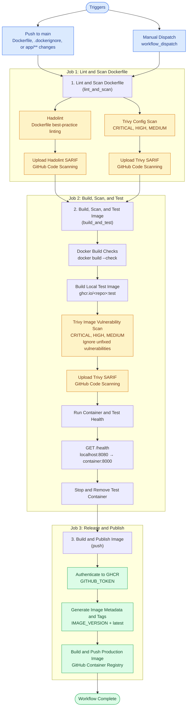
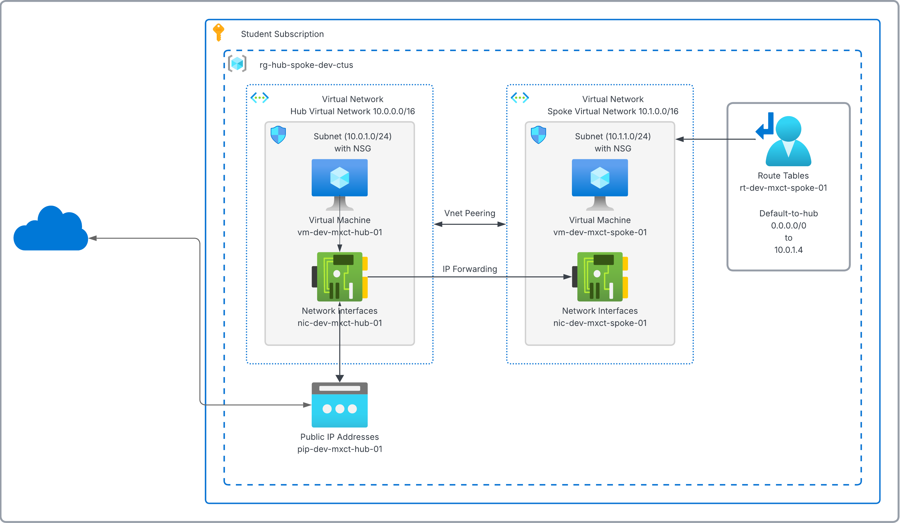
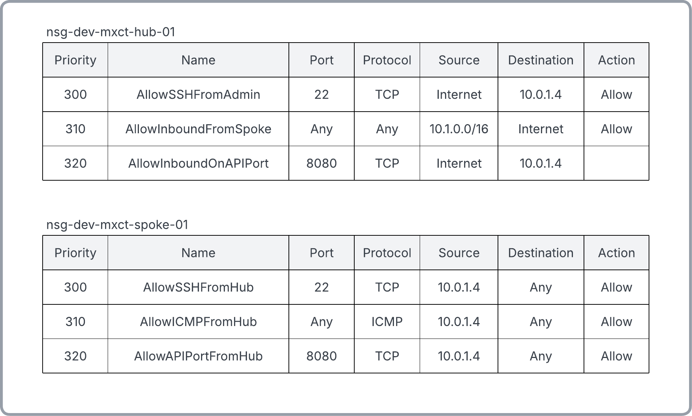

# azure-hub-spoke-ccvs

Automated 2-tier Azure hub-and-spoke network built with Terraform. This project combines custom routing, a hardened containerized backend, and GitHub Actions CI/CD with OIDC-based Azure authentication.

## Container Architecture & Hardening

The backend runs in a multi-stage Docker container based on Python 3.13, using Astral uv for dependency management.

- **Multi-Stage Build:** Separates dependency installation from the runtime image to reduce image size and exclude unnecessary build tools.
- **Security:** Runs the application as a dedicated non-root user (appuser, UID 1001) to minimize runtime privileges.
- **Storage:** Configures /app/data with appropriate permissions for SQLite database operations.
- **Image Hygiene:** Uses a slim Python base image, removes unnecessary package files, and applies Hadolint checks to enforce Dockerfile best practices.

## Automated DevSecOps & Delivery Pipeline

The repository utilizes a modular, multi-stage GitHub Actions workflow enforcing static analysis, container vulnerability scanning, runtime integration testing, and automated image publishing to GitHub Container Registry (GHCR):

## Container CI Workflow

### Pipeline Stages
1. Lint and scan: Hadolint checks Dockerfile quality, and Trivy scans the Dockerfile configuration. Results are uploaded to GitHub Code Scanning in SARIF format.
2. Build, scan, and test: Docker Buildx validates the build, creates a local test image, and runs a Trivy image vulnerability scan. A runtime health check verifies the /health endpoint before the test container is removed.
3. Publish: After the required jobs succeed, GitHub Actions authenticates to GHCR, generates image tags and metadata, and builds and publishes the production image.

## Cloud Architecture

The architecture uses separate hub and spoke virtual networks, with the hub acting as the routing and internet-facing entry point.

  

### Network Security Rules

The network security documentation describes the Network Security Group (NSG) rules governing permitted traffic between the hub, spoke, and external sources.

  

## Tech Stack
* **Cloud Platform:** Microsoft Azure, Azure Virtual Machines, Virtual Networks, VNet Peering, Network Security Groups, User-Defined Routes, Public IP Addresses
* **Infrastructure as Code:** Terraform
* **Containers:** Docker, multi-stage builds
* **CI/CD:** GitHub Actions, OIDC federation, GitHub Container Registry
* **Container security:** Hadolint, Trivy, GitHub Code Scanning